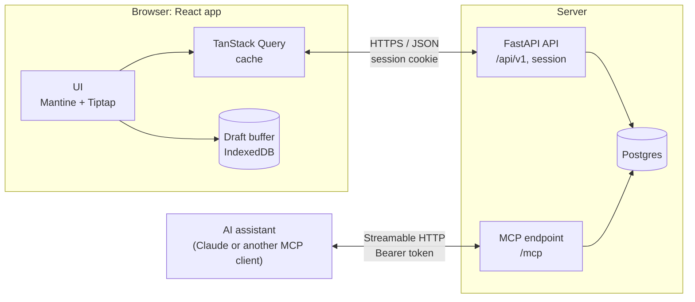

# Notes

A web notes app with a rich-text editor, folders, tags and search. It runs on a FastAPI API with Postgres and includes an MCP server, so AI assistants can read and write your notes.

- **Demo account:** demo@example.com / Demo@2026


## Features

- **Rich-text editor.** Tiptap with the full toolbar: headings, lists, task lists, tables, code blocks with syntax highlighting, links, images, highlight, text colour, alignment, sub/superscript, and word and character counts.
- **Autosave with conflict handling.** Notes save as you type. If the same note was changed in another tab or on another device in the meantime, you choose what to keep, and nothing is lost by default. Unsaved typing is buffered in the browser, so a crash or reload doesn't lose it.
- **Folders, tags and stars.** Nested, coloured folders, tags on any note, and a starred view.
- **Search.** A global search (⌘K / Ctrl+K) across all notes, backed by Postgres full-text search, plus a filter scoped to the current list.
- **Trash.** Deleted notes go to the Trash first and can be restored.
- **MCP server.** AI assistants such as Claude can search, read, create and edit notes through a personal access token. See [Using the MCP server](#using-the-mcp-server).

## Tech stack

| Area | Technologies |
|---|---|
| Frontend | React 19, TypeScript (strict), Vite 8, Mantine 9, TanStack Query 5, Zustand 5, Tiptap 3, React Router, SCSS modules |
| Backend | Python 3.14, FastAPI, Pydantic 2, SQLAlchemy 2, Alembic, Postgres 18, the official `mcp` SDK |
| Tooling | Docker Compose and Caddy, uv, pytest, ruff and mypy (API), Vitest and React Testing Library, ESLint and Stylelint (web) |

Exact versions are pinned in [`web/package.json`](web/package.json) and [`api/pyproject.toml`](api/pyproject.toml), locked in `api/uv.lock`.

## Architecture



- **Serving:** the API serves the built React app from `web/dist`, so the app and the API share one origin ([decision 9](docs/decisions.md)).
- **Sign-in:** the browser authenticates with a server-side session whose id sits in an httpOnly cookie. JavaScript never sees it. Writes from any other origin are rejected.
- **Errors:** every API failure reaches the UI as one error shape. Error boundaries at the root, app, route and editor levels mean a JavaScript error never leaves a blank screen.

## Using the MCP server

The API includes a [Model Context Protocol](https://modelcontextprotocol.io) server. With it, an AI assistant can work with your notes on your behalf: find a note, summarise a folder, or append to a running log. It is served at **`/mcp`** (for example `https://<your-domain>/mcp`) over the Streamable HTTP transport.

### Create a personal access token

1. Sign in to the app and open the account menu → **Access tokens**.
2. Create a token: give it a name, pick its scopes and an expiry.
3. Copy the token right away. Its value is shown only once. The same page shows ready-made connection instructions with the token filled in.

### Scopes and limits

| Scope | Allows |
|---|---|
| `notes:read` | Search and read notes, folders and tags |
| `notes:write` | Also create and edit notes, folders and tags. Write implies read |

- **Scopes are checked inside each tool.** A read-only token sees only an error message from a write tool, telling it which scope is missing.
- **Nothing can be deleted with a token.** No MCP tool deletes, trashes or restores anything, and personal access tokens work only at `/mcp`, never on the REST API.
- **Trash:** notes in the Trash are invisible to the MCP server.
- **Rate limit:** 120 requests per minute.

### Connect Claude

**Claude Code**, from a terminal:

```sh
claude mcp add --transport http notes https://<your-domain>/mcp --header "Authorization: Bearer <your-token>"
```

To share the server with a project instead, add a `.mcp.json` file:

```json
{
  "mcpServers": {
    "notes": {
      "type": "http",
      "url": "https://<your-domain>/mcp",
      "headers": {
        "Authorization": "Bearer <your-token>"
      }
    }
  }
}
```

Don't commit a real token. Use an environment variable (`"Bearer ${NOTES_TOKEN}"`) or keep the file out of version control.

**Claude on claude.ai:** open Customize → Connectors → Add custom connector. Paste the server URL, choose no sign-in, and add an `Authorization` request header with the value `Bearer <your-token>`.

**Other MCP clients:** use the server URL with the Streamable HTTP transport and send the same `Authorization` header with every request.

### Tools

Defined in [`api/app/mcp/`](api/app/mcp), one module per tool group, and registered in [`mcp_server.py`](api/app/mcp/mcp_server.py). Note bodies are exchanged as markdown.

| Tool | Scope | What it does |
|---|---|---|
| `search_notes` | read | Full-text search of titles and bodies. Returns up to 20 matches, most recently updated first, each with an excerpt |
| `list_notes` | read | List notes, optionally by folder, tag or starred. Paginated; returns titles and excerpts, not bodies |
| `get_note` | read | Read one note: title, markdown body, folder, tags, starred flag and version |
| `list_folders` | read | The folder tree, with each folder's colour, position and note count |
| `list_tags` | read | All tags, with the number of notes that carry each |
| `create_note` | write | Create a note with a title and an optional body, folder and tags |
| `update_note` | write | Change a note's title or body. Replaces, appends or prepends; fails if the note changed since `get_note` |
| `move_note` | write | Move a note into a folder, or out of every folder |
| `set_note_starred` | write | Star or unstar a note |
| `duplicate_note` | write | Copy a note (body, folder and tags) into a new note titled "&lt;title&gt; (copy)" |
| `set_note_tags` | write | Replace a note's tags with exactly the given list |
| `add_note_tags` | write | Add tags to a note, keeping the ones it has |
| `remove_note_tags` | write | Take tags off a note. The tags themselves remain |
| `create_folder` | write | Create a folder, at the top level or inside another folder |
| `rename_folder` | write | Rename a folder |
| `set_folder_color` | write | Set a folder's colour as `#rrggbb`, or clear it |
| `reorder_folder` | write | Set a folder's position among its siblings |
| `create_tag` | write | Create a tag without putting it on a note |
| `rename_tag` | write | Rename a tag everywhere it is used |

## Design decisions

**Version-checked saves, resolved by the user.** Every body save carries the note version it was based on. Metadata changes such as starring carry no version, so they never conflict with an autosave in flight. If the note was saved elsewhere in between (another tab, another device, or an AI assistant through the MCP server), the API answers `409 Conflict` with the server's copy. The app then offers **Keep mine**, **Keep theirs** or **Save mine as a copy**. If the note was moved to the Trash in the meantime, it asks whether to restore the note and keep the edit, or discard the edit. This is document-level conflict handling with copies, the model Dropbox and Obsidian Sync use. Real-time merging (CRDTs) was rejected: one person rarely edits the same note in two places at once, and a CRDT would replace readable JSON with binary state that the server can't search.

**Rich text stored as ProseMirror JSON.** Markdown can't express highlight, text colour, alignment or sub/superscript, so it would drop them on every save. The server derives plain text from the JSON for full-text search, and never accepts it from the client, so search can't drift from the content. The MCP server converts bodies to and from markdown at its edge, keeping the formatting markdown can't express as inline HTML.

**Token scopes are checked inside each MCP tool.** The `/mcp` route only admits tokens that carry at least one notes scope. Each tool then declares the scope it needs and checks it before doing anything. A read-only token can still list the write tools, and calling one returns a clear error naming the missing scope. The tools call the same services as the REST API, so the MCP server has no data access of its own. Personal access tokens are accepted only at `/mcp`, which keeps every delete, trash, restore and account route out of their reach.

**Why FastAPI and Postgres.** The app runs on a VPS with Docker. Postgres gives full-text search with a generated, indexed column and an ICU collation that compares names and emails without regard to case or accents ([decision 10](docs/decisions.md)).

Numbered decision records are in [`docs/decisions.md`](docs/decisions.md).

## How it was built

I built this app with a coding agent, working from documents I wrote first: a product spec ([`docs/requirements.md`](docs/requirements.md)) and an architecture document ([`docs/architecture.md`](docs/architecture.md)). Delivery was split into gated stages, and I reviewed and tested every stage before the next one started.

## Local development

### Run the whole app with Docker

`docker-compose.yml` runs everything: Postgres, the FastAPI API (which also serves the React build), a scheduler that removes expired sessions and tokens every day at 23:00 India time, a nightly database backup at 23:10, and Caddy in front. Every service restarts after a crash and whenever Docker starts. The reasons are in decision 10 of [`docs/decisions.md`](docs/decisions.md).

```sh
cp .env.example .env
docker compose up -d --build
```

The app is on `http://127.0.0.1:8000`. The `app` container runs the migrations each time it starts.

**On a server:**
- Run `cp .env.production .env` and set a strong `POSTGRES_PASSWORD` (letters and digits) before the first start. The file holds the rest: the site's origin and the API's production settings. The hosting provider's proxy handles HTTPS and forwards plain HTTP to port 80, so Caddy serves only HTTP. If the domain points straight at the server instead, set `SITE_ADDRESS` to the domain, `HTTPS_PORT=443` and open ports 80 and 443; Caddy then gets the HTTPS certificate itself. `DATABASE_URL` and `ALLOWED_ORIGINS` are built from it in `docker-compose.yml`.
- Run `sudo systemctl enable docker` once, so Docker, and with it the app, starts when the server boots.
- Every push to `master` deploys automatically: GitHub Actions runs the checks, then pulls and rebuilds on the server (decision 6). By hand, it's `git pull && docker compose up -d --build`.

### Backups

The `backup` container dumps the database every day at 23:10 India time and uploads it with [rclone](https://rclone.org/), keeping only the newest backup (decision 11). Set the `BACKUP_REMOTE_*` values in `.env`; with `BACKUP_REMOTE_TYPE` empty, backups are off. The storage account must not use two-factor login.

- **Back up now:** `docker compose exec backup sh /usr/local/bin/backup_now.sh`
- **Is it working?** `docker compose logs backup` shows `backup ok: notes-….dump (size)` after each run, and `docker compose ps` shows the container as unhealthy when the last backup is more than 26 hours old.
- **Restore:** download the `.dump` file from the storage service to the server, then, from the repo root:
  ```sh
  docker compose stop app scheduler
  docker cp notes-….dump notes-postgres:/tmp/restore.dump
  docker compose exec postgres pg_restore -U notes -d notes --clean --if-exists --no-owner /tmp/restore.dump
  docker compose exec postgres rm /tmp/restore.dump
  docker compose start app scheduler
  ```
  `--clean --if-exists` replaces what is in the database with the backup's contents.

### Develop on your machine

Prerequisites: Docker (for Postgres), Node 26, and [uv](https://docs.astral.sh/uv/) (it installs Python 3.14 itself). The API and the web app run natively, so changes show up without rebuilding images.

**1. Start only Postgres** (Postgres 18 on `127.0.0.1:5432`, user and database `notes`, password from `POSTGRES_PASSWORD` in the root `.env`; a `notes_test` database for the tests is created with it):

```sh
cp .env.example .env
docker compose up -d postgres
```

**2. Run the API** on `http://127.0.0.1:8000`:

```sh
cd api
uv sync --frozen
cp .env.example .env               # the defaults match the Postgres above
uv run alembic upgrade head
uv run uvicorn app.main:create_app --factory --reload
```

**3. Run the web app** on `http://localhost:5173`. The Vite dev server forwards `/api` to the API (or to `VITE_API_URL` in `web/.env`), so the session cookie behaves as it does in production:

```sh
cd web
npm ci
npm run dev
```

**Tests and checks:**

```sh
cd api && make check               # ruff, mypy and pytest with coverage, against notes_test
cd web && npm run test             # Vitest
cd web && npm run check            # ESLint, Stylelint, type check and Vitest
```

The API tests use `TEST_DATABASE_URL`, by default the `notes_test` database above.

## Author

Akash Vichhi – https://github.com/akashvichhi – https://www.linkedin.com/in/akash-vichhi
