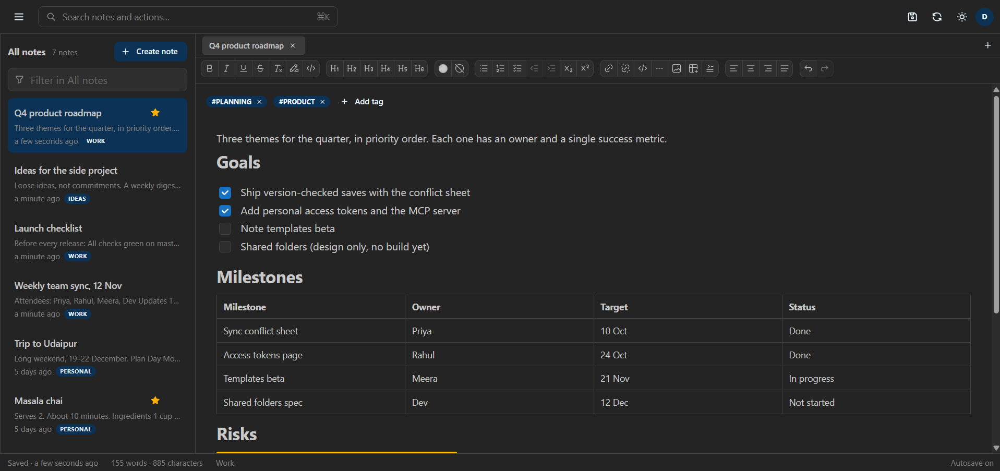
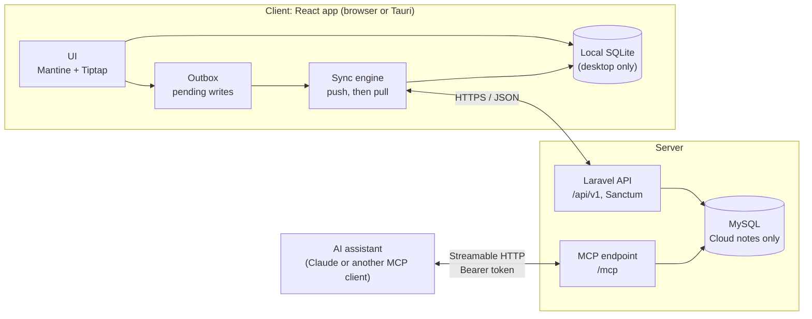

# Notes

A cross-platform notes app: one React codebase ships as a web app and as Tauri desktop apps, backed by a Laravel API on MySQL, with an MCP server so AI assistants can read and write your notes.

- **Live app:** https://notes.codespan.in
- **Demo account:** TODO(akash): demo email / password



## Features

- **Two containers.** Notes live in **Cloud**, synced to your account, or in **On This Device**, which is stored in a local SQLite file and never reaches the server. Each container has its own folders, tags and Trash. The desktop app works without an account; signing in adds Cloud.
- **Offline editing with sync.** In the desktop app, Cloud notes are cached locally and stay editable without a network. Changes queue in a local outbox and sync when the connection returns. If another device changed the same note, you choose what to keep.
- **Folders, tags and stars.** Nested, coloured folders, tags on any note, and a starred view.
- **Search.** A global search (⌘K / Ctrl+K) across notes, backed by MySQL full-text search on the server and SQLite FTS5 on the device, plus a filter scoped to the current list.
- **Rich-text editor.** Tiptap with the full toolbar: headings, lists, task lists, tables, code blocks with syntax highlighting, links, images, highlight, text colour, alignment, sub/superscript, and word and character counts.
- **One codebase, several platforms.** The same React app runs in the browser and in Tauri 2 desktop apps. Everything platform-specific lives in one folder (`web/src/platform/`). TODO(akash): list the desktop platforms that have actually been built and tested, and whether the Android/iOS build exists yet (no mobile project is checked in under `web/src-tauri/gen/`).
- **MCP server.** AI assistants such as Claude can search, read, create and edit Cloud notes through a personal access token. See [Using the MCP server](#using-the-mcp-server).

## Tech stack

| Area | Technologies |
|---|---|
| Frontend | React 19, TypeScript (strict), Vite 8, Mantine 9, TanStack Query 5, Zustand 5, Tiptap 3, React Router, SCSS modules |
| Native shell | Tauri 2, with `tauri-plugin-sql` for the local SQLite database |
| Backend | PHP 8.3, Laravel 13, MySQL 8.4, Laravel Sanctum, `laravel/mcp` |
| Tooling | Docker Compose (MySQL for local development), Pest (API tests), Vitest and React Testing Library (web tests), ESLint, Stylelint |

Exact versions are pinned in [`web/package.json`](web/package.json) and [`api/composer.json`](api/composer.json).

## Architecture



- **Desktop app:** the UI always reads the local SQLite database. The sync engine fills it in the background, so being offline is not a special case.
- **Browser:** the UI reads the API directly and offers only the Cloud container.
- **Server:** it only ever stores Cloud notes. It has no table for On This Device notes and doesn't know they exist.

The browser signs in with Sanctum's httpOnly session cookie. The desktop app loads from its own origin, where that cookie is never sent, so it uses a bearer token kept in the OS secure store ([decision 1](docs/decisions.md)).

The full design is in [`docs/ARCHITECTURE.md`](docs/ARCHITECTURE.md).

## Using the MCP server

The API includes a [Model Context Protocol](https://modelcontextprotocol.io) server. With it, an AI assistant can work with your Cloud notes on your behalf: find a note, summarise a folder, or append to a running log. It is served at **`/mcp`** (for the live app, `https://notes.codespan.in/mcp`) over the Streamable HTTP transport.

### Create a personal access token

1. Sign in to the app and open the account menu → **Access tokens**.
2. Create a token: give it a name, pick its scopes and an expiry.
3. Copy the token right away. Its value is shown only once. The same page shows ready-made connection instructions with the token filled in.

### Scopes and limits

| Scope | Allows |
|---|---|
| `notes:read` | Search and read notes, folders and tags |
| `notes:write` | Also create and edit notes, folders and tags. Write implies read |

- **Scopes are checked inside each tool.** A read-only token sees only an error message from a write tool, telling it which scope is missing.
- **Nothing can be deleted with a token.** No MCP tool deletes, trashes or restores anything, and personal access tokens can never reach the API's delete, trash or account routes.
- **Only Cloud notes are reachable.** Notes in On This Device never reach the server, and notes in the Trash are invisible.
- **Rate limit:** 120 requests per minute.

### Connect Claude

**Claude Code**, from a terminal:

```sh
claude mcp add --transport http notes https://notes.codespan.in/mcp --header "Authorization: Bearer <your-token>"
```

To share the server with a project instead, add a `.mcp.json` file:

```json
{
  "mcpServers": {
    "notes": {
      "type": "http",
      "url": "https://notes.codespan.in/mcp",
      "headers": {
        "Authorization": "Bearer <your-token>"
      }
    }
  }
}
```

Don't commit a real token. Use an environment variable (`"Bearer ${NOTES_TOKEN}"`) or keep the file out of version control.

**Claude on the web, desktop and mobile:** on claude.ai, open Customize → Connectors → Add custom connector. Paste the server URL, choose no sign-in, and add an `Authorization` request header with the value `Bearer <your-token>`.

**Other MCP clients:** use the server URL with the Streamable HTTP transport and send the same `Authorization` header with every request.

### Tools

Defined in [`api/app/Mcp/Tools/`](api/app/Mcp/Tools) and registered in [`NotesServer.php`](api/app/Mcp/Servers/NotesServer.php). Note bodies are exchanged as markdown.

| Tool | Scope | What it does |
|---|---|---|
| `search_notes` | read | Full-text search of titles and bodies. Returns up to 20 matches, most recently updated first, each with an excerpt |
| `list_notes` | read | List notes, optionally by folder, tag or starred. Paginated; returns titles and excerpts, not bodies |
| `get_note` | read | Read one note: title, markdown body, folder, tags, starred flag and version |
| `list_folders` | read | The folder tree, with each folder's colour, position and note count |
| `list_tags` | read | All tags, with the number of notes that carry each |
| `create_note` | write | Create a note with a title and an optional body, folder and tags |
| `update_note` | write | Change a note's title or body. Replaces, appends or prepends; fails if the note changed since `get_note` |
| `move_note` | write | Move a note into a folder, or out of every folder |
| `set_note_starred` | write | Star or unstar a note |
| `duplicate_note` | write | Copy a note (body, folder and tags) into a new note titled "&lt;title&gt; (copy)" |
| `set_note_tags` | write | Replace a note's tags with exactly the given list |
| `add_note_tags` | write | Add tags to a note, keeping the ones it has |
| `remove_note_tags` | write | Take tags off a note. The tags themselves remain |
| `create_folder` | write | Create a folder, at the top level or inside another folder |
| `rename_folder` | write | Rename a folder |
| `set_folder_color` | write | Set a folder's colour as `#rrggbb`, or clear it |
| `reorder_folder` | write | Set a folder's position among its siblings |
| `create_tag` | write | Create a tag without putting it on a note |
| `rename_tag` | write | Rename a tag everywhere it is used |

## Design decisions

**Sync uses a local outbox and per-note versions.** In the desktop app, every change to a Cloud note is written to SQLite first and queued in an outbox. Repeated body edits to the same note are merged into one entry, so an hour of offline typing goes back to the server as a single request. A sync run pushes the outbox first, then pulls the server's current notes, folders and tags. Notes with changes not yet sent keep their local copy.

**Conflicts are resolved by the user, and nothing is lost by default.** Body writes carry the version they were based on. Metadata changes such as starring carry no version, so they never conflict. If another device saved the note in between, the API answers `409 Conflict` with the server's copy, and the app offers three choices: **Keep mine**, **Keep theirs**, or **Save mine as a copy**. If the note was moved to the Trash on another device, the API rejects the edit and the app asks whether to restore the note and keep the edit, or discard the edit. This is document-level sync with conflict copies, the model Dropbox and Obsidian Sync use. CRDTs were rejected: one person across a few devices conflicts rarely, and a CRDT would replace readable JSON with binary state that the server can't search.

The architecture document describes a per-account revision counter with tombstones and a dedicated pull endpoint. That design is not built yet: today's pull fetches the current notes, folders and tags.

**Cloud vs On This Device.** Some notes should never leave the machine, and the app should be useful without an account. On This Device notes live only in a local SQLite file, which the OS backs it up like any other file. IndexedDB was rejected because the browser engine can evict it under storage pressure, and for notes that exist nowhere else, eviction is data loss. The app warns that these notes are not backed up and disappear if it is uninstalled.

**Token scopes are checked inside each MCP tool.** The `/mcp` route only admits tokens that carry at least one notes scope. Each tool then declares the scope it needs and checks it before doing anything. A read-only token can still list the write tools, and calling one returns a clear error naming the missing scope. The tools call the same services and policies as the REST API, so the MCP server has no data access of its own. Personal access tokens are never given the `account` ability, which keeps every delete, trash, restore and account route out of their reach.

**Laravel and MySQL.** Laravel and MySQL were chosen because the app is deployed on shared PHP hosting; on a VPS I would use FastAPI with Docker.

Numbered decision records are in [`docs/decisions.md`](docs/decisions.md). The reasoning behind earlier design choices is in [`docs/CONTEXT.md`](docs/CONTEXT.md).

## How it was built

I built this app with a coding agent, working from documents I wrote first: a product spec ([`docs/SPEC.md`](docs/SPEC.md)), an architecture document ([`docs/ARCHITECTURE.md`](docs/ARCHITECTURE.md)) and a task-by-task plan ([`docs/PLAN.md`](docs/PLAN.md)). Delivery was split into gated stages, and I reviewed and tested every stage before the next one started. The workflow is described in [`docs/BUILDING-WITH-AN-AGENT.md`](docs/BUILDING-WITH-AN-AGENT.md).

## Local development

Prerequisites: Docker, Node 20 or newer, and PHP 8.3 with Composer. The desktop app also needs Rust. TODO(akash): confirm how you run PHP locally. The `app` (PHP) service in `docker-compose.yml` is currently commented out, so Compose starts only MySQL.

**1. Start MySQL** (MySQL 8.4 on port 3306, database `notes`; the root password is set in [`docker-compose.yml`](docker-compose.yml)):

```sh
docker compose up -d
```

**2. Run the API** on `http://127.0.0.1:8000`:

```sh
cd api
composer install
cp .env.example .env
php artisan key:generate
# set DB_CONNECTION=mysql, DB_HOST=127.0.0.1, DB_DATABASE=notes and the MySQL credentials in .env
php artisan migrate --seed
php artisan serve
```

**3. Run the web app** on `http://localhost:5173`. The Vite dev server forwards `/api` and `/sanctum` to the API, so cookies and CSRF behave as they do in production:

```sh
cd web
npm ci
npm run dev
```

**4. Run the desktop app** (optional):

```sh
cd web
npm run tauri:dev
```

**Tests and checks:**

```sh
cd api && php artisan test     # Pest feature and unit tests
cd web && npm run test         # Vitest
cd web && npm run check        # ESLint, Stylelint, type check and Vitest
```

More detail on the Docker environment is in [`docs/SETUP-WINDOWS.md`](docs/SETUP-WINDOWS.md), and on the production build in [`PRODUCTION-BUILD.md`](PRODUCTION-BUILD.md).

## Author

Akash Vichhi – https://github.com/akashvichhi – https://www.linkedin.com/in/akash-vichhi
